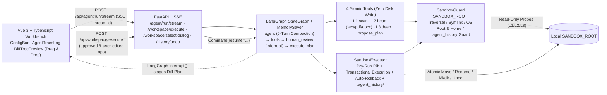

<div align="center">

# SafeWorkspace Agent

**Local Sandboxed AI File Organization Workbench**


**English** | [简体中文](README_zh.md)

</div>

> **SafeWorkspace Agent** is an open-source local file organization agent built around three core engineering pillars:
> **Context Engineering** (L1–L3 Progressive Disclosure + 6-Turn Context Compaction) · **Strict Sandbox** (Zero Direct Write Privileges + Defense-in-Depth Path Guard) · **Human-in-the-Loop** (LangGraph Native `interrupt()` Checkpoints + Interactive Drag-and-Drop Diff Approval + Transactional One-Click Undo).

---

## Screenshots

> Drop your UI screenshots into [`docs/screenshots/`](docs/screenshots/) using the filenames below and uncomment the image tags to render them on GitHub:

| 1. L1–L3 Progressive Disclosure Trace & Multi-Turn Chat | 2. Before/After Directory Tree Diff & Drag-and-Drop Editing |
| :---: | :---: |
| `docs/screenshots/workbench-trace.png` | `docs/screenshots/diff-drag-drop.png` |
| <!--  --> *(Add workbench trace & L1–L3 probe stream screenshot)* | <!--  --> *(Add side-by-side Diff, drag-and-drop & manual badge screenshot)* |

| 3. Dynamic Workspace Switcher & Persistent BYOK Config | 4. `.agent_history/` Transactional Audit & One-Click Undo |
| :---: | :---: |
| `docs/screenshots/workspace-switcher.png` | `docs/screenshots/history-undo.png` |
| <!--  --> *(Add top sandbox switcher & native folder dialog screenshot)* | <!--  --> *(Add rollback history journal & Undo button screenshot)* |

---

## Architecture



---

## Core Features

### 1. Context Engineering: L1 → L2 → L3 Progressive Disclosure
Avoids dumping entire local workspaces into the LLM context window, dramatically reducing token cost and noise:
- **L1 (`scan_directory_tree`)**: Lightweight directory structure and metadata scan (names, extensions, sizes, timestamps), automatically skipping `.agent_history`, `.git`, `node_modules`, and `__pycache__`.
- **L2 (`inspect_file_head`)**: On-demand lightweight probing ONLY for ambiguous or generic filenames (e.g., `scan_8821.txt`, `IMG_001.pdf`, `lab_report.docx`) — reads opening text lines, Word `.docx` paragraphs & cover tables (`python-docx`), or PDF page 1 + metadata (`pypdf`). Binary/image files safely return metadata summaries instead of raw bytes.
- **L3 (`read_file_deep`)**: Bounded line-range deep inspection invoked only when L1 + L2 are genuinely insufficient for disambiguation.

### 2. Single-Workspace Multi-Turn Memory & Context Compaction
Reuses LangGraph's built-in `MemorySaver` + `thread_id` checkpointer with zero external database dependencies:
- **Continuous Multi-Turn Refinement**: When the agent asks clarifying questions or completes a pass, follow-up user prompts automatically carry `currentThreadId` and stream seamlessly into the unified conversation & trace timeline.
- **Token-Safe Compaction (`compact_messages_for_llm`)**: Before every LLM call, history is compacted cleanly on `HumanMessage` turn boundaries — retaining the System Prompt + **most recent 6 turns** (strictly preserving `tool_call_id` pairs) while folding oversized historical `ToolMessage` payloads into compact placeholders without mutating the audit checkpoint.
- **New Chat & Workspace Isolation**: Dedicated **`+ New Chat`** (`+ 新增对话`) button resets `currentThreadId`, clears traces and pending diffs; switching `SANDBOX_ROOT` automatically performs a silent reset on both frontend and backend to prevent cross-directory context leakage.

### 3. Strict Sandbox: Zero Direct Write Privileges & Defense-in-Depth Guard
- **Least-Privilege LLM Tooling**: All **4 atomic tools** bound to the LLM have **zero disk mutation or deletion privileges** (no `delete`, no `write`, no shell execution). Even `propose_organization_plan` only performs in-memory dry-run validation, parent/child operation order conflict detection, and virtual tree simulation.
- **Path Security Guard (`SandboxGuard`)**:
  - Anchored strictly to the resolved `SANDBOX_ROOT`; refuses filesystem/drive roots (`C:\`, `D:\`, `/`), protected OS system directories (`Windows`, `Program Files`, `/etc`, `/System`), and the user's home root directory (`~`).
  - Blocks `../` / `..\` path traversal, out-of-sandbox absolute paths, UNC paths, null bytes (`\x00`), Windows ADS (`file:stream`), reserved OS device names (`CON`, `NUL`, `PRN`), and external symlink escapes.
  - Protects `.agent_history/` and `.git/` from agent access and streams live `security_blocked` SSE alerts whenever an escape attempt is intercepted.

### 4. LangGraph `interrupt()` Checkpoints & Visual Drag-and-Drop Diff Approval
- **Native `interrupt()` Suspension**: Once the agent stages a validated proposal, LangGraph pauses at `human_review` with **zero bytes modified on disk**.
- **Interactive Before/After Tree Diff (`DiffTreePreview.vue`)**:
  - Side-by-side Before/After tree preview with per-operation checkboxes that recompute the virtual After Tree in **0ms**.
  - **HTML5 Native Drag & Drop**: Drag any file directly onto any target folder (or root dropzone) in the After Tree to adjust its destination, automatically add a `move` op, or cancel the op when dragged back to its original path — tagging user edits with a **`Manual`** (`手动调整`) badge.
  - **Quick Inline Editing**: Supports **`+ New Folder`** virtual `mkdir` creation, **double-click inline renaming** (with cascading target updates when renaming newly created folders), and one-click **Reset to AI Original Plan**.

### 5. Transactional Execution & `.agent_history/` One-Click Undo
- Submitting confirmation sends the final selected & user-adjusted `operations` to `POST /api/workspace/execute`, where `SandboxGuard` re-validates every single path before executing in deterministic topological order.
- Any mid-batch filesystem failure (e.g., locked file or unexpected conflict) triggers automatic reverse rollback of all completed steps in the batch.
- Every executed batch is recorded with step details, created directories, and file SHA-256 fingerprints in `SANDBOX_ROOT/.agent_history/batch_*.json`, supporting one-click atomic **Undo** and safe cleanup of empty created folders.

### 6. Persistent BYOK Config & Dynamic Native Folder Switching
- Compatible with any OpenAI-standard endpoint (OpenAI, DeepSeek, OpenRouter, vLLM, local Ollama, etc.).
- Saving config in the Web UI automatically persists to `backend/.local_config.json` (gitignored; higher startup priority than `.env`), eliminating repeated API key entry across restarts while returning only masked keys to the UI.
- Clicking the top-center `SANDBOX_ROOT` pill opens the Workspace Switcher supporting native OS folder selection (`POST /api/workspace/select-dialog` via isolated `tkinter` subprocess), manual path input, and 1-click switching across the 5 most recent workspaces.

---

## Directory Structure

```text
safe-workspace-agent/
├── README.md                    # English documentation
├── README_zh.md                 # Simplified Chinese documentation
├── LICENSE                      # MIT License
├── .env.example                 # Environment template (OPENAI_API_KEY, OPENAI_BASE_URL, MODEL_NAME, SANDBOX_ROOT)
├── .gitignore                   # Ignores secrets, .local_config.json, demo_sandbox/, .agent_history/, build outputs
├── start.bat                    # Windows one-click launcher
├── start.sh                     # macOS / Linux one-click launcher
├── docs/
│   └── screenshots/             # UI showcase screenshots directory
├── backend/
│   ├── requirements.txt
│   ├── tests/
│   │   └── test_safe_workspace.py   # 17 backend security, L1-L3, multi-turn & transactional undo E2E tests
│   └── app/
│       ├── __init__.py
│       ├── main.py              # FastAPI entry, CORS, SSE streaming, native folder dialog, execute & undo APIs
│       ├── config.py            # Pydantic Settings + `.local_config.json` local persistence
│       ├── schemas.py           # Shared Pydantic v2 data contracts
│       ├── sandbox/
│       │   ├── __init__.py
│       │   ├── guard.py         # Strict SANDBOX_ROOT path guard (traversal, symlink & OS root defense)
│       │   ├── readers.py       # L1/L2/L3 progressive file probes (Text / Code / PDF / DOCX)
│       │   └── executor.py      # Dry-run diff simulator + transactional executor + `.agent_history/` Undo log
│       └── agent/
│           ├── __init__.py
│           ├── tools.py         # 4 atomic tools bound to LLM (zero direct disk writes)
│           └── graph.py         # LangGraph state machine, 6-turn context compaction & native interrupt()
└── frontend/
    ├── index.html
    ├── package.json
    ├── tsconfig.json
    ├── vite.config.ts
    └── src/
        ├── main.ts
        ├── style.css
        ├── api/client.ts        # Typed API client & POST SSE stream parser
        ├── stores/workspace.ts  # Pinia store (multi-turn session, trace log, drag-drop Diff edits, history)
        ├── components/
        │   ├── ConfigBar.vue        # Top workspace switcher + native folder picker + BYOK modal
        │   ├── AgentTraceLog.vue    # Left panel: multi-turn chat, L1/L2/L3 probe stream & New Chat CTA
        │   └── DiffTreePreview.vue  # Right panel: Before/After Diff, drag-and-drop, inline rename, execute & undo
        └── App.vue
```

---

## Quick Start

### Option 1: One-Click Launcher (Recommended)
- **Windows**: Double-click [`start.bat`](start.bat) (or run `.\start.bat` in terminal). It automatically locates Python 3.11+, checks dependencies, starts Backend (`:8000`) and Frontend (`:5173`), and opens the workbench in your browser.
- **macOS / Linux**:
  ```bash
  chmod +x start.sh && ./start.sh
  ```

### Option 2: Manual Setup

#### 1. Environment Variables (Optional)
```bash
cp .env.example .env
# Optional: fill in OPENAI_API_KEY, OPENAI_BASE_URL, MODEL_NAME, SANDBOX_ROOT
# Or leave empty and configure directly in the Web UI (auto-persisted to backend/.local_config.json)
```

#### 2. Start Backend (FastAPI + LangGraph)
Requires **Python 3.11+**:
```bash
cd backend
pip install -r requirements.txt
uvicorn app.main:app --host 0.0.0.0 --port 8000
```

Run the full backend test suite (17 tests):
```bash
cd backend
pytest tests/test_safe_workspace.py -v
```

#### 3. Start Frontend (Vue 3 + Vite)
Requires **Node.js 20+**:
```bash
cd frontend
npm install
npm run dev
```

Open `http://localhost:5173`:
1. Click the top-center `SANDBOX_ROOT` pill to pick any local workspace directory (or click **Seed Demo Files** to try with sample messy documents).
2. Click the top-right model badge to enter your OpenAI-compatible **BYOK API Key** (persisted locally for future restarts).
3. Enter your organization goal on the left, observe live **L1 → L2 → L3** disclosure traces, refine across multiple turns, and review/drag-and-drop/rename in the right-hand **Diff Preview** before committing with one-click Undo protection.

---

## API Reference

| Method | Path | Description |
| :--- | :--- | :--- |
| `GET` | `/api/health` | Service health check |
| `GET` | `/api/config` | Current sandbox path, recent workspaces, file stats & masked BYOK model config |
| `PUT` | `/api/config` | Switch `SANDBOX_ROOT` or update BYOK config (persisted to `backend/.local_config.json`) |
| `GET` | `/api/workspace/tree` | Live L1 directory tree snapshot of active sandbox |
| `POST` | `/api/workspace/select-dialog` | Open native OS folder dialog in isolated subprocess & validate via `SandboxGuard` |
| `POST` | `/api/workspace/seed-demo` | Safely populate sample messy workspace files inside sandbox (non-overwriting) |
| `POST` | `/api/agent/run/stream` | Start or continue a `thread_id` LangGraph session via SSE streaming |
| `POST` | `/api/workspace/execute` *(alias: `/api/agent/confirm`)* | Resume LangGraph `interrupt()` with approved & manually adjusted `operations` for transactional execution |
| `GET` | `/api/history` | List all persisted `.agent_history/` transaction batches |
| `POST` | `/api/history/{batch_id}/undo` | Atomically revert an executed batch and restore original directory structure |

---

## License

[MIT License](LICENSE)
