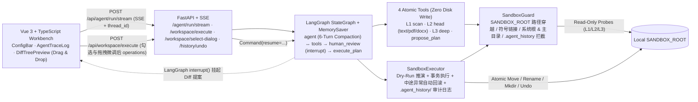

# SafeWorkspace Agent


> **安全本地沙盒文件整理智能体** — 基于 **Context Engineering (L1-L3 渐进式披露 + 多轮上下文防爆裁剪)** + **Strict Sandbox (零直接写权限 + 纵深路径越权拦截)** + **Human-in-the-Loop (LangGraph 原生 `interrupt()` 状态挂起 + 可视化拖拽微调 Diff + 事务级一键回滚)** 构建的开源本地文件整理工作台。

---

## 界面预览 (Screenshots)

> 请将运行截图保存至 [`docs/screenshots/`](docs/screenshots/) 目录并按如下文件名命名，即可在 GitHub 主页自动渲染展示：

| 1. L1-L3 渐进式披露轨迹流 & 多轮对话工作台 | 2. 整理前后目录树 Diff 对比 & 可视化拖拽微调 |
| :---: | :---: |
| `docs/screenshots/workbench-trace.png` | `docs/screenshots/diff-drag-drop.png` |
| <!--  --> *(待补充主界面与 L1-L3 探针流截图)* | <!--  --> *(待补充前后目录树对比、拖拽归类与手动调整徽章截图)* |

| 3. 动态工作区切换 & BYOK 持久化配置 | 4. `.agent_history/` 事务审计与一键撤回 |
| :---: | :---: |
| `docs/screenshots/workspace-switcher.png` | `docs/screenshots/history-undo.png` |
| <!--  --> *(待补充顶部沙盒切换面板与原生目录弹窗截图)* | <!--  --> *(待补充事务回滚日志与一键 Undo 截图)* |

*(上传图片后，去掉上方 Markdown 表格中的 `<!-- ... -->` 注释符号即可立即生效。)*

---

## 核心架构 (Architecture)



---

## 核心特性 (Core Features)

### 1. Context Engineering：L1 → L2 → L3 渐进式披露
拒绝将整个工作区盲目塞入 LLM 上下文，显著降低 Token 消耗与噪声：
- **L1 (`scan_directory_tree`)**：仅扫描目录树结构与轻量元数据（文件名、扩展名、大小、修改时间），自动忽略 `.agent_history`、`.git`、`node_modules`、`__pycache__`。
- **L2 (`inspect_file_head`)**：仅对命名模糊的文件（如 `scan_8821.txt`、`IMG_001.pdf`、`实验报告.docx`）按需读取前 N 行文本摘要、Word `.docx` 正文段落与封面表格（通过 `python-docx`）或 PDF 首页与元数据（通过 `pypdf`）；二进制/图片文件自动返回安全元信息而不注入乱码。
- **L3 (`read_file_deep`)**：仅当 L1 + L2 仍不足以分类消歧时，按行号范围受控深度读取片段。

### 2. 单工作区多轮会话记忆与上下文防爆裁剪
直接复用 LangGraph `MemorySaver` 与 `thread_id` 检查点机制（零额外数据库依赖）：
- **连续多轮追问与指令细化**：当 Agent 反问澄清偏好或完成一轮整理后，前端自动携带 `currentThreadId` 追加发送并渲染完整对话气泡流。
- **上下文防爆压缩 (`compact_messages_for_llm`)**：每次调用 LLM 前自动按轮次边界保留 System Prompt 与**最近 6 轮**交互消息（严格维持 `tool_call_id` 配对完整），并将更早历史轮次中超长的 `ToolMessage`（L1/L2/L3 原始大段文本）折叠替换为简短摘要占位，避免多轮对话撑爆 Token 预算。
- **会话隔离与一键重置**：左侧面板顶部提供显著的 **`+ 新增对话`** 按钮；切换 `SANDBOX_ROOT` 工作区时前后端均自动触发会话隔离重置，防止旧目录上下文污染新工作区。

### 3. Strict Sandbox：零直接写权限 + 纵深路径越权拦截
- **LLM 工具最小权限原则**：绑定给大模型的 **4 个原子工具** 均无任何磁盘写入、修改或删除权限（无 `delete`、无 `write`、无 Shell 执行）。即便调用 `propose_organization_plan`，也仅在内存中执行 Dry-Run 校验、父子目录顺序冲突检测与虚拟目录树 Diff 推演。
- **纵深路径守卫 (`SandboxGuard`)**：
  - 严格锚定解析后的 `SANDBOX_ROOT`，拒绝挂载盘符/文件系统根目录（`C:\`、`D:\`、`/`）、系统目录（`Windows`、`Program Files`、`/etc`、`/System`）及**用户主目录根层级**（`~`）。
  - 全面拦截 `../` / `..\` 路径穿越、跨盘符绝对路径、UNC 网络路径、空字节注入 (`\x00`)、Windows ADS (`file:stream`)、保留设备名 (`CON`/`NUL`/`PRN`) 及指向沙盒外部的符号链接逃逸。
  - 强制保护 `.agent_history/` 与 `.git/` 禁止被智能体读写或移动，越权尝试实时通过 SSE `security_blocked` 事件告警。

### 4. LangGraph `interrupt()` 状态挂起 + 可视化拖拽微调 Diff
- **原生 `interrupt()` 检查点挂起**：智能体提交提案后，状态机在 `human_review` 节点挂起，此时本地磁盘 **零字节变更**。
- **可视化交互式审批 (`DiffTreePreview.vue`)**：
  - 左右分栏呈现整理前 (`Before`) / 整理后 (`After`) 目录树对比，支持单条操作勾选/取消 **0ms 实时联动** 重算预览树。
  - **HTML5 原生拖拽归类**：可在 `After` 预览树中直接将任意文件拖拽至任意目标文件夹或根目录，自动更新/新增 `move` 或拖回原路径自动取消操作，并高亮标注 **`手动调整`** 徽章。
  - **配套快捷编辑**：支持 **`+ 新建文件夹`** 生成虚拟目录、**双击 inline 重命名**（新建目录重命名时自动级联更新子文件路径），以及随时一键 **「重置为 AI 原始方案」**。

### 5. 事务级执行 + `.agent_history/` 一键回滚
- 点击「确认执行所选」后将最终勾选与拖拽微调后的 `operations` 提交至后端，经 `SandboxGuard` 二次严格校验后按确定性拓扑顺序执行。
- 批内若遇到中途异常（如文件被占用或外部冲突），事务执行器自动逆序全量回滚已执行步骤，保证目录一致性。
- 每次执行批次均记录操作明细、新建目录列表与文件 SHA-256 指纹至 `SANDBOX_ROOT/.agent_history/batch_*.json`，支持随时在「事务回滚日志」面板一键 **Undo** 恢复原状并安全清理新建空目录。

### 6. BYOK 本地持久化 & 动态工作区切换
- 兼容任意标准 OpenAI API 格式服务端（OpenAI、DeepSeek、OpenRouter、vLLM、Ollama 本地模型等）。
- 前端保存配置后自动持久化至 `backend/.local_config.json`（已加入 `.gitignore`，启动优先级高于 `.env`），重启后免重填 API Key；界面始终仅回显脱敏掩码。
- 点击顶部 `SANDBOX_ROOT` 路径胶囊弹出工作区切换面板，支持通过独立子进程调用系统原生文件夹选择框 (`POST /api/workspace/select-dialog`)、手动输入路径及最近 5 个工作区一键切换。

---

## 目录结构 (Directory Structure)

```text
safe-workspace-agent/
├── README.md                    # 开源项目文档与架构说明
├── LICENSE                      # MIT 开源协议
├── .env.example                 # 环境变量模板 (OPENAI_API_KEY, OPENAI_BASE_URL, MODEL_NAME, SANDBOX_ROOT)
├── .gitignore                   # 严格忽略密钥、测试沙盒、回滚日志与构建产物
├── start.bat                    # Windows 一键启动脚本
├── start.sh                     # macOS / Linux 一键启动脚本
├── docs/
│   └── screenshots/             # README 界面展示截图目录
├── backend/
│   ├── requirements.txt
│   ├── tests/
│   │   └── test_safe_workspace.py   # 17 项后端安全、L1-L3、多轮记忆与事务回滚端到端测试
│   └── app/
│       ├── __init__.py
│       ├── main.py              # FastAPI 入口、CORS、SSE 流式接口、目录选择框、执行与撤回接口
│       ├── config.py            # Pydantic Settings + `.local_config.json` 本地持久化配置管理
│       ├── schemas.py           # 前后端共享 Pydantic v2 数据契约
│       ├── sandbox/
│       │   ├── __init__.py
│       │   ├── guard.py         # SANDBOX_ROOT 路径安全守卫 (Path Traversal & 系统目录拦截)
│       │   ├── readers.py       # L1/L2/L3 渐进式披露文件探针 (Text / Code / PDF / DOCX)
│       │   └── executor.py      # Dry-Run Diff 推演 + 事务级执行器 + `.agent_history/` 回滚日志
│       └── agent/
│           ├── __init__.py
│           ├── tools.py         # 绑定给 LLM 的 4 个原子工具 (零直接磁盘写权限)
│           └── graph.py         # LangGraph 状态机、6 轮上下文防爆压缩、Interrupt 挂起与恢复逻辑
└── frontend/
    ├── index.html
    ├── package.json
    ├── tsconfig.json
    ├── vite.config.ts
    └── src/
        ├── main.ts
        ├── style.css
        ├── api/client.ts        # API 封装与 POST SSE 流式解析器
        ├── stores/workspace.ts  # Pinia 状态管理 (多轮会话、轨迹流、拖拽编辑 Diff、历史批次)
        ├── components/
        │   ├── ConfigBar.vue        # 顶部工作区切换面板 + 原生目录选择 + BYOK 配置弹窗
        │   ├── AgentTraceLog.vue    # 左侧：多轮对话与 L1/L2/L3 探针轨迹流 +「+ 新增对话」
        │   └── DiffTreePreview.vue  # 右侧：前后目录树 Diff 对比、拖拽归类、双击改名、执行与撤回
        └── App.vue
```

---

## 快速启动 (Quick Start)

### 方式一：一键启动脚本（推荐）
- **Windows**：直接双击项目根目录的 [`start.bat`](start.bat)（或在终端执行 `.\start.bat`），脚本将自动探测 Python 3.11+ 环境与依赖、同时拉起后端 (`:8000`) 与前端 (`:5173`) 并在就绪后自动打开浏览器。
- **macOS / Linux**：
  ```bash
  chmod +x start.sh && ./start.sh
  ```

### 方式二：手动分别启动

#### 1. 准备环境变量（可选）
```bash
cp .env.example .env
# 编辑 .env 填入 OPENAI_API_KEY / OPENAI_BASE_URL / MODEL_NAME / SANDBOX_ROOT
# 也可留空直接启动，随后在 Web UI 顶部弹窗中实时填写并自动持久化到 backend/.local_config.json
```

#### 2. 启动后端 (FastAPI + LangGraph)
需要 **Python 3.11+**：
```bash
cd backend
pip install -r requirements.txt
uvicorn app.main:app --host 0.0.0.0 --port 8000
```

运行后端全部单元测试与集成测试：
```bash
cd backend
pytest tests/test_safe_workspace.py -v
```

#### 3. 启动前端 (Vue 3 + Vite)
需要 **Node.js 20+**：
```bash
cd frontend
npm install
npm run dev
```

打开浏览器访问 `http://localhost:5173`：
1. 点击顶部居中 `SANDBOX_ROOT` 路径胶囊可弹出本地文件夹选择框切换工作区，或点击 **「生成示例文件」** 快速体验。
2. 点击右上角模型按钮配置您的 **BYOK API Key**（自动本地持久化，重启免重填）。
3. 在左侧输入整理指令并观察 **L1 → L2 → L3** 渐进式披露轨迹流；支持继续多轮追问微调，或点击 **`+ 新增对话`** 开启全新上下文。
4. LangGraph 中断挂起后，在右侧自由勾选、拖拽文件到目标文件夹、新建虚拟目录或双击重命名，确认执行后随时可在「事务回滚日志」中一键撤回。

---

## 核心 API 接口一览

| Method | Path | 说明 |
| :--- | :--- | :--- |
| `GET` | `/api/health` | 服务健康检查 |
| `GET` | `/api/config` | 获取当前沙盒路径、最近工作区、文件统计与脱敏模型配置 |
| `PUT` | `/api/config` | 运行时切换 `SANDBOX_ROOT` 或更新 BYOK 配置并持久化至 `backend/.local_config.json` |
| `GET` | `/api/workspace/tree` | 获取当前沙盒实时目录树 (L1) |
| `POST` | `/api/workspace/select-dialog` | 启动独立子进程弹出系统原生文件夹选择框并经 `SandboxGuard` 校验 |
| `POST` | `/api/workspace/seed-demo` | 在当前沙盒内安全生成示例测试文件（不覆盖已有文件） |
| `POST` | `/api/agent/run/stream` | 启动或延续指定 `thread_id` 的 LangGraph 会话并流式推送 SSE 事件 |
| `POST` | `/api/workspace/execute` (兼容 `/api/agent/confirm`) | 恢复 LangGraph `interrupt` 状态，提交最终勾选及拖拽/重命名微调后的 `operations` 并事务执行 |
| `GET` | `/api/history` | 读取 `.agent_history/` 全部事务执行批次记录 |
| `POST` | `/api/history/{batch_id}/undo` | 原子逆序撤回指定批次并恢复沙盒目录结构 |

---

## License

[MIT License](LICENSE)
