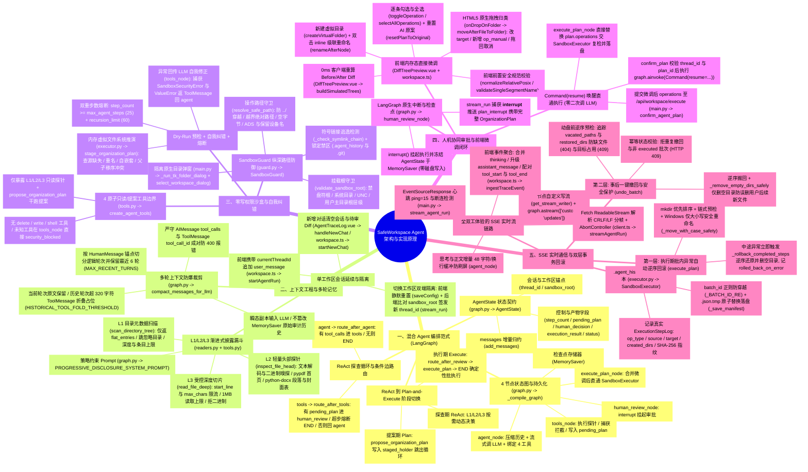

# SafeWorkspace Agent 架构与实现原理思维导图

> 本文档严格对照当前仓库真实源码生成，每个核心技术节点均标注对应源码文件与关键符号，用于深度架构复盘与技术面试准备。
> - **可视化预览**：直接渲染下方 Mermaid `mindmap` 代码块（GitHub / VS Code / Typora / Obsidian 均原生支持）。
> - **导图导入**：复制第二部分「标准层级 Markdown 大纲」，可直接导入 **XMind**（Markdown 导入）或 **Markmap** 生成交互式思维导图。

---

## 一、可视化架构思维导图（Mermaid `mindmap`）

---

## 二、标准层级 Markdown 大纲（支持直接导入 XMind / Markmap）

# SafeWorkspace Agent 架构与实现原理

## 一、混合 Agent 编排范式（LangGraph）
- **状态契约设计** (`backend/app/agent/graph.py -> AgentState`)
  - `messages: Annotated[list[BaseMessage], add_messages]`：利用 `add_messages` 归约器实现跨轮次、跨节点的消息自动追加。
  - 会话与工作区锚点：`thread_id`、`sandbox_root`（锁定该线程绑定的沙盒根目录，防跨目录错乱）。
  - 执行控制与中间产物：`step_count`（单轮步数计数）、`pending_plan`（暂存的 Dry-Run 提案字典）、`human_decision`（人工审批与微调载荷）、`execution_result`（物理批次账本）、`status`（`running / awaiting_approval / executed / cancelled / completed / error`）。
- **四节点有向状态图与检查点** (`backend/app/agent/graph.py -> SafeWorkspaceAgentRunner._compile_graph()`)
  - 节点构成：`agent` (`agent_node`)、`tools` (`tools_node`)、`human_review` (`human_review_node`)、`execute_plan` (`execute_plan_node`)。
  - 状态持久化：编译时注入内存级 `MemorySaver()` (`SafeWorkspaceAgentRunner.__init__`)，无额外外部数据库依赖。
  - 动态模型工厂：`agent_node` 运行时经 `_build_llm()` 读取 `RunnableConfig["configurable"]` 实例化 `ChatOpenAI(streaming=True)`，兼容 OpenAI / DeepSeek / OpenRouter / 本地 Ollama BYOK 配置 (`backend/app/config.py -> RuntimeConfigStore`)。
- **ReAct 探查循环与条件边路由分发** (`backend/app/agent/graph.py`)
  - 入口边：`START -> agent`。
  - `route_after_agent(state)`：检测末条 `AIMessage` 是否包含 `tool_calls`——有则路由至 `tools`，无则直接 `END`（自然支持纯文本澄清反问或答疑，不强行生成无效 Plan）。
  - `route_after_tools(state)`：三路分发——① `pending_plan is not None` 立即切入 `human_review`；② `step_count >= max_agent_steps` 触发熔断至 `END`；③ 否则回环 `agent` 继续下一轮 ReAct 探查或自我修正。
- **ReAct → Plan-and-Execute 混合切换机制** (`backend/app/agent/graph.py`, `backend/app/agent/tools.py`)
  - **探查阶段（ReAct）**：由 LLM 根据目录现状动态决定调用哪些 L1/L2/L3 探针，灵活应对未知文件结构。
  - **提案阶段（Plan 冻结）**：LLM 调用 `propose_organization_plan` (`tools.py -> _tool_propose_organization_plan()`) 通过校验后写入闭包容器 `staged_holder["plan"]`，`tools_node` 将其存入 `AgentState["pending_plan"]` 并切状态为 `awaiting_approval`，跳出 ReAct 循环。
  - **执行阶段（Execute 确定性落盘）**：经 `human_review` 审批唤醒后由 `route_after_review()` 路由至 `execute_plan -> END`，全程确定性代码执行，不再调用大模型。

## 二、上下文工程与多轮记忆
- **L1 / L2 / L3 渐进式披露漏斗** (`backend/app/sandbox/readers.py`, `backend/app/agent/tools.py`)
  - Prompt 强约束 (`graph.py -> PROGRESSIVE_DISCLOSURE_SYSTEM_PROMPT`)：强制先 L1 扫描全局，仅对命名模糊文件按需 L2 探针，仅当 L1+L2 无法消歧时才升级 L3，严禁盲目全量读文件。
  - **L1 轻量元数据扫描** (`readers.py -> scan_directory_tree()`, `tools.py -> _tool_scan_directory_tree()`):
    - 仅向 LLM 返回精简 `flat_entries`（`path / type / size / ext / mtime`），不读文件内容。
    - 跳过 `IGNORED_SCAN_DIRS`（`.agent_history`、`.git`、`__pycache__`、`node_modules`、`.venv` 等）与 `IGNORED_SCAN_FILES`。
    - 遍历时校验符号链接不逃逸出 `SANDBOX_ROOT`，并受 `max_depth`（默认 4，最大 8）与 `max_entries`（默认 400，最大 2000）硬上限保护。
  - **L2 轻量头部与文档大纲探针** (`readers.py -> inspect_file_head()`, `tools.py -> _tool_inspect_file_head()`):
    - 文本/代码文件：最多采样 64KB，按 `utf-8-sig / utf-8 / gb18030 / latin-1` 依次解码 (`_decode_bytes()`)，前 4KB 执行控制字符与 `\x00` 比例嗅探 (`_is_likely_binary()`)，截取前 `max_lines` 行与 `l2_max_chars`（1800 字符），并估算总行数。
    - PDF 文档 (`_read_pdf_head()`)：基于 `pypdf.PdfReader` 提取页数、文档元数据与第 1 页文本摘要。
    - Word `.docx` 文档 (`_extract_docx_blocks()`, `_read_docx_head()`)：基于 `python-docx` 提取核心属性、非空段落以及前 8 张表的非空行（覆盖实验报告封面表），无依赖时降级 `zipfile + xml.etree.ElementTree` 解析 `word/document.xml`。
    - 图片/压缩包/二进制文件：仅返回文件名、字节数与 MIME 类型摘要，杜绝二进制乱码污染上下文。
  - **L3 深度切片读取** (`readers.py -> read_file_deep()`, `tools.py -> _tool_read_file_deep()`):
    - 支持 `start_line` / `max_lines` / `l3_max_chars`（默认 8000 字符）受控切片；PDF 最多取前 10 页，文本原始读取封顶 1MB，直接拒绝二进制文件。
- **多轮上下文防爆压缩** (`backend/app/agent/graph.py -> compact_messages_for_llm()`)
  - **按 `HumanMessage` 轮次边界裁剪**：将 `state["messages"]` 按每个 `HumanMessage` 拆分为完整逻辑轮次，仅保留最近 `MAX_RECENT_TURNS = 6` 轮。因裁剪发生在轮次边界而非固定消息条数，**严格保证了 `AIMessage(tool_calls)` 与对应 `ToolMessage(tool_call_id)` 永远成对存在**，彻底避免 OpenAI 兼容接口报 HTTP 400。
  - **历史超长探针结果自动折叠**：当前活跃轮次（最后一轮）所有工具返回原文保留；更早保留轮次中内容长度超过 `HISTORICAL_TOOL_FOLD_THRESHOLD = 320` 字符的 `ToolMessage`，自动构造新 `ToolMessage` 替换为 `[历史探针结果已折叠 (<tool_name>，原 N 字符)，如需最新状态请重新扫描]`，并完整保留原 `tool_call_id` 与 `name`。
  - **无损检查点**：裁剪仅作用于传入 LLM 的瞬态消息列表，不覆盖 `MemorySaver` 中的完整历史。
- **单工作区多轮会话延续与隔离** (`backend/app/agent/graph.py`, `frontend/src/stores/workspace.ts`, `frontend/src/components/AgentTraceLog.vue`)
  - 会话连续性：`AgentRunRequest.thread_id` (`schemas.py`) 为空时后端签发新 `thread_id` 并通过首帧 SSE `run_started` 同步前端；前端 `workspace.ts -> startAgentRun()` 保存并携带 `currentThreadId`，保留历史 `traceItems` 并追加 `user_message` 气泡实现多轮对话微调。
  - 一键新会话：`AgentTraceLog.vue -> handleNewChat()` 调用 `workspace.ts -> startNewChat()` -> `resetSessionState()`，中止活跃流、清空 `currentThreadId`、轨迹与未执行的挂起 Diff。
  - 跨工作区防污染双保险：切换 `SANDBOX_ROOT` 时，前端 `workspace.ts -> saveConfig()` 自动静默调用 `resetSessionState()`；后端 `graph.py -> stream_run()` 也通过 `aget_state()` 检查 `prev_root != resolved_root`，不匹配时强制签发全新 `thread_id`。

## 三、零写权限沙盒与自我纠错
- **4 个只读/提案原子工具边界** (`backend/app/agent/tools.py -> create_agent_tools()`, `TOOL_PROBE_LEVELS`)
  - 绑定给 LLM 的全部工具仅限：`scan_directory_tree` (L1)、`inspect_file_head` (L2)、`read_file_deep` (L3)、`propose_organization_plan` (PLAN)，物理上不存在 `delete`、`write`、Shell 执行能力，仅允许非破坏性动作（`mkdir / move / rename / archive`）。
  - 工具白名单防线：`graph.py -> tools_node()` 若检测到 `tool_map.get(name) is None`，直接发射 `security_blocked` 事件并拒绝执行。
- **`SandboxGuard` 纵深路径防御** (`backend/app/sandbox/guard.py -> SandboxGuard`)
  - **工作区挂载守卫** (`SandboxGuard.validate_sandbox_root()`, `config.py -> RuntimeConfigStore.update()`):
    - 拦截文件系统/盘符根目录（`resolved == resolved.parent`，如 `C:\`、`D:\`、`/`）与 UNC 网络路径（`\\`、`//`）。
    - 拦截操作系统受保护目录及其全部子目录（Windows 下 `Windows / Program Files / Program Files (x86) / ProgramData / $Recycle.Bin / System Volume Information` 及环境变量动态读取；POSIX 下 `/etc / usr / bin / sbin / var / sys / proc / dev / System / Library` 等）。
    - 拦截系统用户根目录（`C:\Users`、`/Users`、`/home`）以及当前用户主目录根层级（`Path.home()`），仅放行业务/个人子目录。
    - 配套动态目录选择：`main.py -> select_workspace_dialog()` 通过 `asyncio.to_thread(_run_tk_folder_dialog)` 启动独立 Python 子进程弹出 `tkinter.filedialog.askdirectory`，避免阻塞 FastAPI 事件循环与 GUI 线程冲突，返回前立即经 `validate_sandbox_root()` 校验，并将最近 5 个工作区与 BYOK 配置原子持久化至 `backend/.local_config.json` (`config.py -> _persist_config()`)。
  - **沙盒内访问守卫** (`SandboxGuard.resolve_safe_path()`):
    - 拦截 `None`、空字节 `\x00`、UNC 路径、直接针对 `SANDBOX_ROOT` 本身的写操作。
    - 拦截 `../`、`..\`、混斜杠路径穿越与指向沙盒外部的绝对路径（词法归一化 `os.path.normpath` + `Path.resolve()` 双重 `is_relative_to(self.root)` 校验）。
    - 逐级检查符号链接逃逸 (`_check_symlink_chain()`)：沿祖先路径逐段检查 `is_symlink()`，解析目标越界即阻断。
    - 保护禁区目录 (`PROTECTED_DIR_NAMES = {".agent_history", ".git"}`) 禁止智能体读写移动。
    - 目标文件名合规校验 (`_validate_segments()`)：拦截 Windows ADS 冒号 `:`、非法字符 `<>"|?*`、尾部空格/点号以及 OS 保留设备名 (`RESERVED_WINDOWS_NAMES`: `CON / PRN / AUX / NUL / COM1-9 / LPT1-9`)。
- **Dry-Run 预检、自我纠错闭环与步数熔断**
  - **Dry-Run 内存虚拟推演** (`backend/app/sandbox/executor.py -> stage_organization_plan()`):
    - 零磁盘写入：基于 `scan_directory_tree` 构建 `virtual_files`、`virtual_dirs`、`moved_sources`、`moved_dir_map`，模拟所有操作生成标注后的 `before_tree` 与 `after_tree`。
    - 严格拦截：源文件缺失、重复移动同一源、目标路径重名碰撞（放行 Windows 仅大小写改名）、目录移入自身子目录、以及**先移父目录再引用旧子路径的顺序冲突** (`_find_moved_ancestor()`)。
  - **异常回传 LLM 自我纠错** (`backend/app/agent/graph.py -> tools_node()`):
    - 捕获 `SandboxSecurityError`：推送 `security_blocked` SSE 告警，同时将 `[SANDBOX_GUARD BLOCKED] ...` 封装为 `ToolMessage` 回传模型。
    - 捕获 `ValueError` 等 Dry-Run 校验异常：不写入 `pending_plan`，将 `[TOOL_ERROR] <详细冲突提示与修正建议>` 封装为 `ToolMessage` 回传，由 `route_after_tools()` 路由回 `agent_node` 驱动 LLM 自主修正路径或操作顺序后重新提案。
  - **防无限循环双熔断**：`route_after_tools()` 校验 `step_count >= app_settings.max_agent_steps`（默认 25 步）强制终止；同时 `stream_run()` 显式向 LangGraph 注入 `recursion_limit = max_agent_steps * 2 + 10`（默认 60）。

## 四、人机协同审批与前端微调闭环
- **LangGraph 原生中断与内存检查点快照** (`backend/app/agent/graph.py`)
  - 挂起机制：`human_review_node()` 调用原生 `interrupt({"type": "human_approval_required", "thread_id": ..., "plan": plan_payload})` 暂停执行，当前完整 `AgentState` 冻结保存于 `MemorySaver`，此时本地文件系统保持零写入。
  - 前端送达：`stream_run()` 监听 `graph.astream` 的 `updates` 通道捕获 `__interrupt__`，将其封装为 `plan_interrupt` SSE 事件（携带完整 `OrganizationPlan`）推送至前端。
- **前端内存态直接微调与 0ms 实时 Diff（无需二次调 LLM）** (`frontend/src/stores/workspace.ts`, `frontend/src/components/DiffTreePreview.vue`)
  - 快照与实时模拟：收到 `plan_interrupt` 时 `workspace.ts -> ingestTraceEvent()` 深拷贝留存 `originalPlanOperations` 与可编辑 `pendingPlan.operations`；`DiffTreePreview.vue -> buildSimulatedTrees()` 监听勾选集合 `selectedOperationIds` 与操作数组变化，在浏览器内存 0ms 重算 `before / after` 双树并扁平化渲染 (`flattenTree()`)。
  - **原生 HTML5 拖拽归类** (`DiffTreePreview.vue -> onDragStart() / onDragOverFolder() / onDragLeaveFolder() / onDropOnFolder()`, `workspace.ts -> moveAfterFileToFolder()`):
    - 支持将 After Tree 任意文件节点拖入目标文件夹或顶部根目录 Dropzone（含虚线边框高亮与防子元素闪烁判断）。
    - 自动规范化目标 POSIX 路径与碰撞校验：已有对应操作则改写 `target` 并自动重算 `op_type` (`inferOpType()`)；未在提案中的文件自动新增 `op_manual_xxx`；拖回原路径自动取消操作；所有手动改动统一打标 `manual_adjusted = true` 展示 **`手动调整`** 徽章。
  - **配套快捷编辑**：
    - 虚拟新建目录：`DiffTreePreview.vue -> submitNewFolder()` -> `workspace.ts -> createVirtualFolder()` 即时插入 `op_type: "mkdir"` 并置顶分组。
    - 双击 inline 重命名：`DiffTreePreview.vue -> startInlineRename() / commitInlineRename()` -> `workspace.ts -> renameAfterNode()` 支持文件自动选中扩展名前主体改名；重命名新建虚拟目录时自动级联更新其下所有子文件操作的 `target`（及链式 `source`）前缀。
    - 颗粒度审批与重置：逐条勾选 / 全选 / 全不选 (`toggleOperation() / selectAllOperations() / clearSelectedOperations()`)；前端前置安全校验 (`normalizeRelativePosix() / validateSingleSegmentName()`)；一键撤销全部人工微调恢复 AI 原案 (`resetPlanToOriginal()`)。
- **`Command(resume)` 唤醒直通物理执行器** (`frontend/src/api/client.ts`, `backend/app/main.py`, `backend/app/agent/graph.py`)
  - 提交最终态：`workspace.ts -> confirmPendingPlan()` 经 `client.ts -> apiClient.confirmPlan()` 向 `POST /api/workspace/execute`（`main.py -> confirm_agent_plan()`，兼容路由 `/api/agent/confirm`）提交 `thread_id`、`plan_id`、`approved`、`approved_operation_ids` 以及前端最终编辑好的完整 `operations`。
  - 检查点校验与唤醒：`graph.py -> confirm_plan()` 先经 `aget_state()` 核验线程存在、确处于挂起态 (`snapshot.next`) 且 `plan_id` 匹配，再调用 `graph.ainvoke(Command(resume=resume_payload), config)` 唤醒 `human_review_node`。
  - 零 LLM 直通落盘：拒绝或勾选为空时直接清空 `pending_plan` 结束至 `END`；批准时 `route_after_review()` 路由进入 `execute_plan_node()`，用 `decision["operations"]` 替换 `plan.operations` 后直接交给 `SandboxExecutor.execute_plan()` 执行（**绝不再次调用大模型**，且每条人工微调路径仍强制通过 `SandboxGuard` 二次校验，非法路径直接 HTTP 403 拦截）。

## 五、SSE 实时通信与双层事务回滚
- **SSE 实时事件流通信机制**
  - 后端双通道聚合 (`backend/app/agent/graph.py`):
    - 节点内部通过 `get_stream_writer()` 发射自定义事件：`thinking`（区分 `reasoning_delta` 与 `content_delta`，采用 48 字符或换行缓冲防高频碎片事件）、`tool_start`、`tool_end`（经 `_summarize_tool_output()` 裁剪摘要）、`security_blocked`、`assistant_message`。
    - `stream_run()` 订阅 `graph.astream(initial_state, config, stream_mode=["custom", "updates"])`，透传 `custom` 事件并将 `updates` 中的 `__interrupt__` 转为 `plan_interrupt`，收尾补发 `done`（含 `awaiting_approval` 标志）。
  - FastAPI 流式网关 (`backend/app/main.py -> stream_agent_run()`): 基于 `sse_starlette.sse.EventSourceResponse(event_generator(), ping=15)` 输出标准 SSE（`event / id / data`），每帧检测 `request.is_disconnected()` 及时释放服务端协程。
  - 前端流式解析与智能归并 (`frontend/src/api/client.ts -> streamAgentRun()`, `frontend/src/stores/workspace.ts -> ingestTraceEvent()`):
    - 使用 `fetch` + `ReadableStream` + `TextDecoder({ stream: true })` 支持 POST Body 传参，兼容 `\r\n\r\n` 与 `\n\n` 双分帧格式，支持 `AbortController` 随时中断流，并将底层 `Failed to fetch` 翻译为中文服务连通性提示。
    - `ingestTraceEvent()` 实现同类型 `thinking` 流平滑拼接、纯文本回复结束时将 `content_delta` 气泡原地升级为 `assistant_message`（消除重复渲染）、并将 `tool_end` / `security_blocked` 精准回填配对到对应 `tool_start` 探针卡片。
- **`.agent_history/` 物理事务账本** (`backend/app/sandbox/executor.py -> SandboxExecutor`)
  - 账本结构：`ExecutionBatchRecord` + `ExecutionStepLog`（`schemas.py`），逐条记录真实物理变更：`operation_id`、`op_type`、`source`、`target`、`status`、精确追踪的新建目录清单 `created_dirs` (`_ensure_parents_tracked()`) 以及 <=50MB 常规文件的 SHA-256 指纹 (`_compute_file_sha256()`)。
  - 防篡改与原子落盘：`_manifest_path()` 用正则 `_BATCH_ID_RE` 校验 `batch_id` 防止路径穿越；`_save_manifest()` 先写入 `.json.tmp` 再经 `os.replace()` 原子替换至 `SANDBOX_ROOT/.agent_history/batch_*.json`。
- **第一层：执行期批内异常自动逆序回滚** (`backend/app/sandbox/executor.py -> SandboxExecutor.execute_plan()`)
  - 确定性拓扑与二次防线：勾选子集按 `mkdir` 优先排序；动盘前执行防御性 `SandboxGuard` 全量预检（兼容前序步骤生成的链式目标与目录内子文件）；执行期拒绝覆盖已有目标，并对 Windows NTFS 仅大小写重命名通过临时中间名两步安全改名 (`_move_with_case_safety()`)。
  - 原子回滚：任一步骤抛出异常（如文件被占用、权限不足、外部突增冲突），立即进入 `except` 调用 `_rollback_completed_steps(completed_steps)`——按已完成步骤**严格逆序**搬回原路径并调用 `_remove_empty_dirs_safely()` 最深优先清理空目录，批次标记 `status = "rolled_back_on_error"` 并记录失败步骤 `operation_id` 与原因持久化归档。
- **第二层：事后一键撤回的冲突与存在性保护** (`backend/app/main.py -> undo_execution_batch()`, `backend/app/sandbox/executor.py -> SandboxExecutor.undo_batch()`)
  - 幂等与状态锁：校验目标批次必须为 `executed`，对已撤回 (`reverted`) 或非执行态批次直接拒绝（HTTP 409）。
  - 动盘前逆序预检：逆序模拟每条已完成步骤，维护 `vacated_paths`（支持链式互换移动还原）与 `restored_dirs`（支持父目录+子文件联动撤回）；若已移文件在磁盘失踪则抛 `FileNotFoundError`（HTTP 404），若原路径已被新文件占用则抛 `FileExistsError`（HTTP 409），绝不半途破坏磁盘。
  - 安全物理还原：通过预检后严格逆序搬回原路径；清理 `created_dirs` 时由 `_remove_empty_dirs_safely()` 按目录深度降序逐个检查 `not any(path.iterdir())`，**仅删除空目录**，保护用户事后手动放入目录的新文件，最终更新账本 `status = "reverted"` 与 `reverted_at`。
